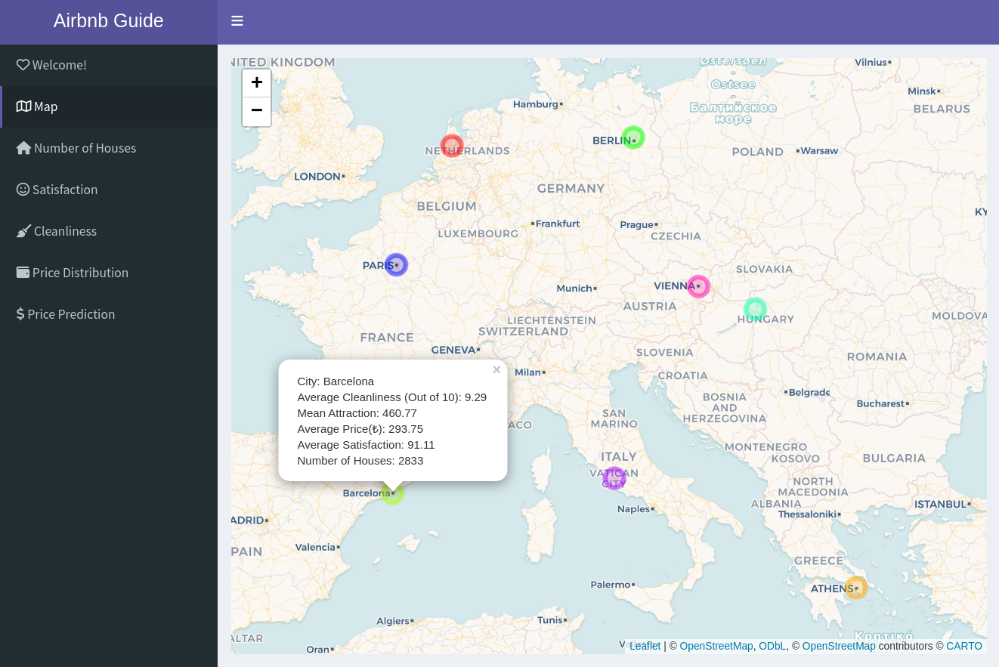
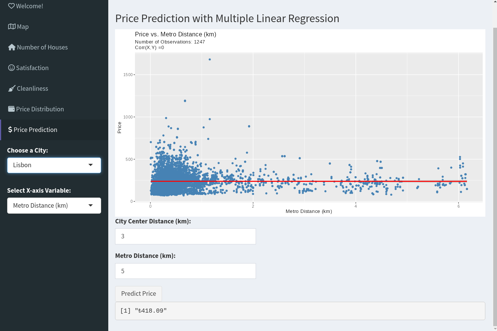
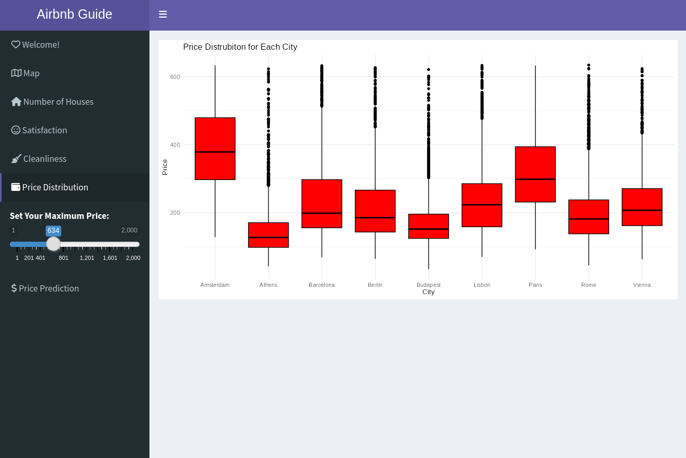

# Airbnb Guide for Europe

An R Shiny dashboard for browsing Airbnb listings in nine European cities, built as a course project.

## Data

`Aemf1.csv` has 41,714 Airbnb listings from Amsterdam, Athens, Barcelona, Berlin, Budapest, Lisbon, Paris, Rome and Vienna (Rome has the most with 9,027, Amsterdam the fewest with 2,080).

Columns: city, price, weekday/weekend, room type, shared/private room, person capacity, superhost, multiple rooms, business, cleanliness rating, guest satisfaction, bedrooms, distance to city center (km), distance to metro (km), attraction index, restaurant index and their normalised versions.

## What the app does

The app is a `shinydashboard` with these tabs:

- **Map**: a Leaflet map with one marker per city. The popup shows average cleanliness, attraction index, price, guest satisfaction and the number of listings.
- **Number of Houses**: bar chart of listings per city.
- **Satisfaction**: price vs. guest satisfaction for a chosen city, person capacity and minimum cleanliness rating.
- **Cleanliness**: price box plots by cleanliness rating, filtered by city, capacity and maximum price.
- **Price Distribution**: price box plots for each city below a maximum price set with a slider.
- **Price Prediction**: for a chosen city, a scatter plot of price against distance to the city center or the metro with a linear fit. The user enters both distances and the app predicts a price from a linear regression `Price ~ city center distance + metro distance` fit on that city's listings.

## Screenshots

Map:



Price prediction:



Price distribution by city:



## How to run

Install the packages:

```r
install.packages(c("shiny", "shinydashboard", "leaflet", "maps", "tidyverse"))
```

`app.R` reads the data from an absolute path. Change the `read.csv(...)` line to `read.csv("Aemf1.csv")`, then run this from the repo folder:

```r
shiny::runApp()
```

## Limitations

- The price model only uses the two distance variables, so it is a simple illustration, not a real pricing model. In the Lisbon screenshot above, the correlation between price and metro distance rounds to 0.
- The repo does not document the currency of the price column. The app labels prices with ₺, which I have not verified against the source data.
- On the Price Prediction tab, the "Number of Observations" subtitle counts the rows from the Satisfaction tab filter, not the selected city.
- The correlation shown on the Cleanliness tab is computed on the full dataset, not the filtered data.
